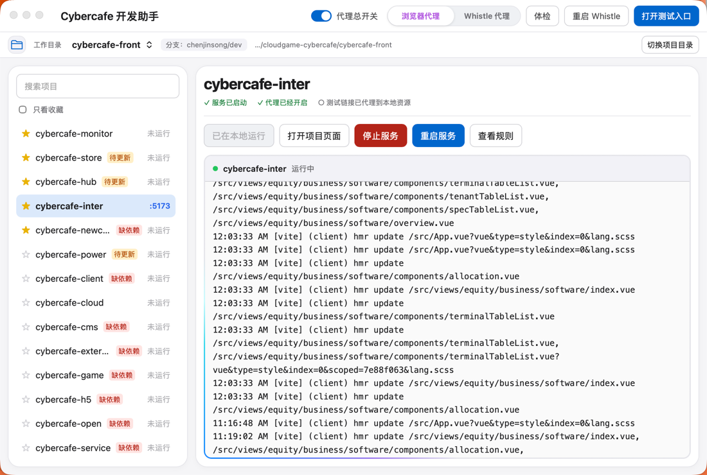
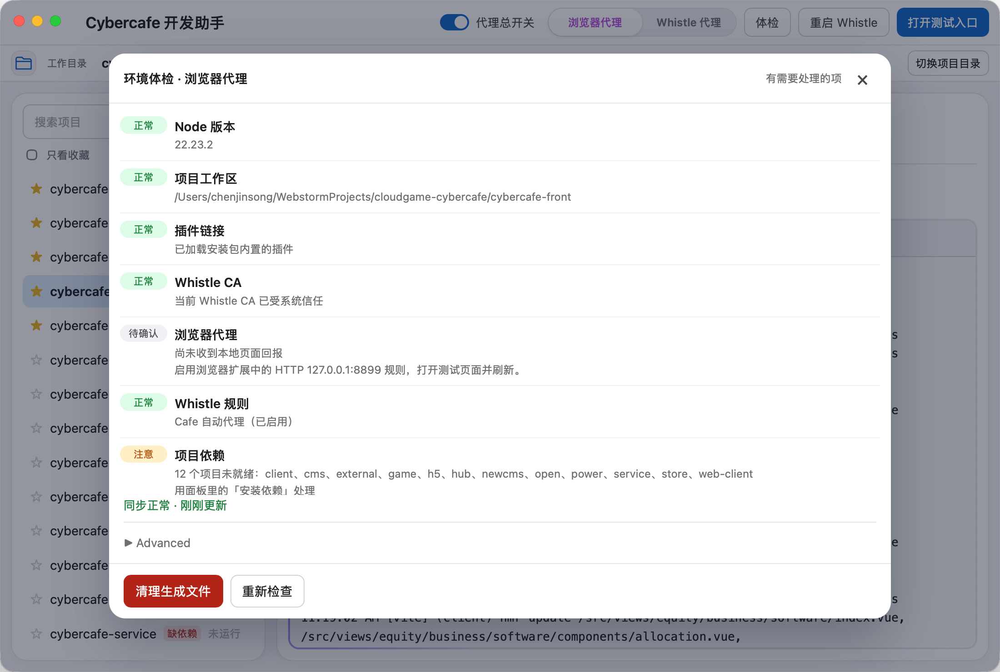
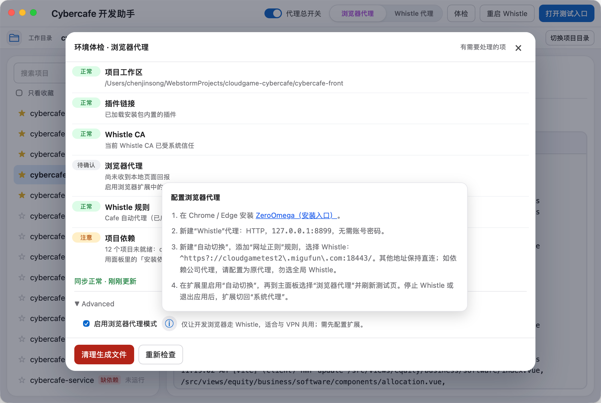

# whistle-dev-launcher

Cybercafe 本地调试工具：通过 Whistle 将测试环境的 `cybercafe-*` 子应用接到本机服务，保留入口、路径和登录流程，不修改业务仓库。

- 面板：<http://127.0.0.1:8899/plugin.cafe-projects/>
- 托管规则：`Cafe 自动代理`
- 页面徽标：`本地接管 / 测试部署`
- 安装、证书、代理和故障处理见 [使用说明](使用说明.md)。



<details>
<summary>查看环境体检与浏览器代理配置</summary>





</details>

## 快速开始

1. 安装 Node.js 20+（含 npm），下载对应平台的安装包。
2. 打开应用：自动启动或复用 Whistle；缺少时后台执行 `npm install -g whistle`，已有版本不自动升级。
3. 点击「选择项目目录」，选择直接包含 `cybercafe-hub` 等子项目的工作区。目录通过系统选择器或最近记录选择，并自动保存。
4. 启动项目，按体检提示处理依赖、证书和代理，再打开项目页面。

项目输出显示在主面板下方，不弹外部终端。切换工作区会先确认并停止原目录的托管服务；外部服务不停止，日志保留。关闭主窗口会清理项目服务、终端任务及本工具修改的代理，停止本工具启动且仍由其管理的 Whistle，然后退出。

安装包不内置 Node/npm/Whistle；使用安装包不需要 Rust 或 Xcode。macOS 使用 ad-hoc 签名，首次打开遇到系统拦截时按使用说明处理。

## 代理模式

桌面端默认隐藏模式切换。在「体检 → Advanced」勾选「启用浏览器代理模式」后显示，勾选状态和代理模式分别保存，重启后保留。旁边的 ⓘ 提供 ZeroOmega 安装和分流说明。

| 模式 | 行为 |
| --- | --- |
| Whistle 代理 | 自动配置测试域名 PAC，退出时恢复原设置，不覆盖用户后来选择的其他 PAC。 |
| 浏览器代理 | 浏览器扩展将测试域名 `18443` 端口转到 `127.0.0.1:8899`，需手动配置并启用扩展；退出应用后切回系统代理。 |

项目页面统一使用默认浏览器，代理检查、模式选择和访问确认均由主面板与体检提供。

## 开发与打包

### 平台构建与系统能力

- macOS：DMG、ad-hoc 签名；修改系统 PAC 需系统授权，浏览器标签页复用需自动化权限。
- Windows：NSIS EXE、当前用户安装；目前使用浏览器代理，系统 PAC 自动配置及精确标签页复用尚未实现。

### 本机开发

macOS 首次构建需要 Rust、Xcode 命令行工具、Node.js 和 Python 3：

```sh
./scripts/commands/启动桌面端.command
./scripts/commands/启动桌面端.command --rebuild
```

开发应用位于 `.cafe-tools/Cybercafe.app`，依赖当前仓库资源，不单独分发。修改 Rust、图标或原生配置后需重新构建；源码修改不会自动更新已安装应用。

```sh
npm --prefix whistle.cafe-projects test
cargo fmt --manifest-path desktop/Cargo.toml --check
cargo test --locked --manifest-path desktop/Cargo.toml
```

登录后落地页统一配置在 `whistle.cafe-projects/shared/config/login-targets.js`，例如：

```js
store: '/cybercafe-store/#/merchant/store/list',
```

登录回跳适配只在工具侧注入，保留业务校验与权限流程。

### 安装包

推荐 GitHub Actions：选择 **Build desktop packages → Run workflow**，完成后从 Artifacts 下载 macOS Apple Silicon DMG 或 Windows x64 EXE，保留 14 天。本机无需 Rust。

推送 tag 会构建该 tag，并在两端均成功后上传至 GitHub Release：

```sh
git tag v1.0.1
git push origin v1.0.1
```

手动运行时，`release_tag` 留空只生成 Artifacts；填写已有 tag 则构建并发布该版本。先提交需要发布的修改，再打 tag；重新运行旧 tag 不会包含新代码。

本机仅构建 macOS DMG：

```sh
./scripts/commands/打包.command --mac-only
# 可选：--output-dir /tmp/cybercafe-dist
```

产物默认放在 `dist/`，文件名带香港时间的构建日期，同日同平台再次构建会覆盖。`CAFE_DIST_DIR` 可指定输出目录。版本以 `desktop/Cargo.toml` 为准，与 `tauri.conf.json` 校验一致后写入应用。

Windows 使用 NSIS 当前用户安装；两端共用应用名称 `Cybercafe 本地调试`。资源由 `desktop/packaging/resources.py` 统一收集，不包含测试、依赖目录和本机缓存。

## 项目官网

官网源码位于 `docs/site/`，使用 GitHub Pages 发布。首次在仓库 **Settings → Pages → Source** 选择 **GitHub Actions**，将网站改动合入 `main` 后自动部署，也可手动运行 **Deploy website**。

默认地址：<https://Zephyr-Aether.github.io/whistle-dev-launcher/>。安装包构建成功后会刷新最新 Release 下载入口；私有仓库下载仍需 GitHub 访问权限。私有仓库启用 Pages 取决于组织套餐和设置，请勿为部署更改仓库可见性。

本地预览：`node scripts/build-site.mjs`，然后用静态 HTTP 服务打开 `.cafe-tools/site/`。网站不依赖前端框架，不影响桌面端打包。

## 代码目录与职责

功能放在 `features/`，公共能力放在 `shared/`。同一功能的 UI、服务端和资源集中维护，`client.mjs` 负责交互，`server.cjs` / `store.cjs` 负责本机操作与状态。

### 插件与界面

以下路径相对于 `whistle.cafe-projects/`。

| 目录 | 职责 |
| --- | --- |
| `panel/` | 主面板、全局布局、深浅主题和功能初始化。 |
| `features/projects/` | 项目列表、收藏、启停、状态和操作编排；准备中每 3 秒刷新，空闲每 15 秒刷新，失败时逐步退避至 120 秒，恢复后重置，隐藏时暂停。 |
| `features/workspace/` | 目录选择、最近记录、分支、切换与持久化。 |
| `features/terminal/` | 后台启动服务、内嵌终端和输出展示。 |
| `features/doctor/` | 环境、证书、代理检查与修复。 |
| `features/system-proxy/` | 代理模式、Advanced 选项和 PAC。 |
| `features/rules/` | 规则预览、复制和内嵌编辑器。 |
| `features/whistle/` | Whistle 重启、规则查询与代理关闭清理。 |
| `features/window-controls/` | 桌面工具栏拖动和 Windows 窗口按钮。 |
| `features/badge/` | 测试页环境徽标。 |
| `features/proxy/` | 服务检测、规则同步和浏览器访问确认。 |
| `features/startup/` | 启动进度、失败原因和超时。 |
| `features/dependencies/` | 依赖安装、任务状态和安装后启动。 |
| `features/runtime/` | 按项目约束选择 Node 和包管理器。 |
| `features/logs/` | 日志采集、归档、诊断和按工作区隔离；`session.cjs` 为工具启动的项目共用一个日志进程，保留独立服务进程组和清空请求；`run-log.cjs` 保留日志写入能力及旧包装入口。 |
| `features/cleanup/` | 清理生成文件、临时状态和日志。 |
| `features/browser/` | 默认浏览器打开入口。 |
| `features/navigation/` | 仅测试域名的工具入口加载登录脚本，保留同标签页回跳；门户监听收敛到门户节点，profile 补查仅在 power 登录入口执行，最多 40 次，成功、离开或页面关闭即停止。 |
| `shared/toast/` | 公共胶囊提示，错误显示 2 秒，持续错误去重。 |
| `shared/http/` | 请求、令牌、本机鉴权和操作确认。 |
| `shared/config/` | 公共路径、测试入口和登录目标配置。 |
| `server/` | 页面资源映射和 API 路由；插件入口为 `index.cjs`。 |
| `test/` | 按功能组织关键回归测试，避免为单个修复新增零散文件。 |

### 桌面端与工具

以下路径相对于仓库根目录。

| 目录或文件 | 职责 |
| --- | --- |
| `desktop/src/main.rs` | 应用初始化与系统事件。 |
| `desktop/src/menu/` | 菜单、后台操作和状态反馈。 |
| `desktop/src/window/` | 窗口、原生按钮、导航与下载范围。 |
| `desktop/src/lifecycle/` | 串行启停、退出清理和失败保护。 |
| `desktop/src/services/` | 共用服务流程；仅环境查找和进程操作保留平台差异，嵌入脚本按需安装 Whistle。 |
| `desktop/src/system_proxy/` | macOS PAC 接管、原设置备份、恢复与授权。 |
| `desktop/capabilities/` | 仅向本机面板授予必要的窗口操作权限。 |
| `desktop/ui/` | 连接异常页面。 |
| `desktop/icons/` | 同款应用与 Dock 图标；修改时同步 PNG 和 ICNS。 |
| `desktop/packaging/` | 共用资源收集、应用组装和签名。 |
| `desktop/package-macos.sh` | 生成 DMG。 |
| `desktop/windows/` | NSIS 安装钩子和旧版内置运行时清理。 |
| `docs/site/` | Apple 风格静态官网，包含截图、安装说明与多端下载入口。 |
| `scripts/build-site.mjs` | 收集官网资源并在 CI 读取最新 Release；输出 `.cafe-tools/site/`，不向浏览器暴露令牌。 |
| `docs/images/` | README 等文档使用的界面截图。 |
| `.github/workflows/` | 云端测试、打包和 Release 发布。 |
| `scripts/commands/` | 用户可执行的 `.command` 入口。 |
| `scripts/browser/` | macOS 默认浏览器标签页复用。 |
| `scripts/preview-panel.cjs` | 只读面板预览，默认端口 `18997`。 |
| `.cafe-tools/`、`dist/` | 本机数据、构建缓存及分发产物，均由 Git 忽略。 |

移动模块时同步检查引用、静态资源映射和打包入口。其他协作约定见 [AGENTS.md](AGENTS.md)。
